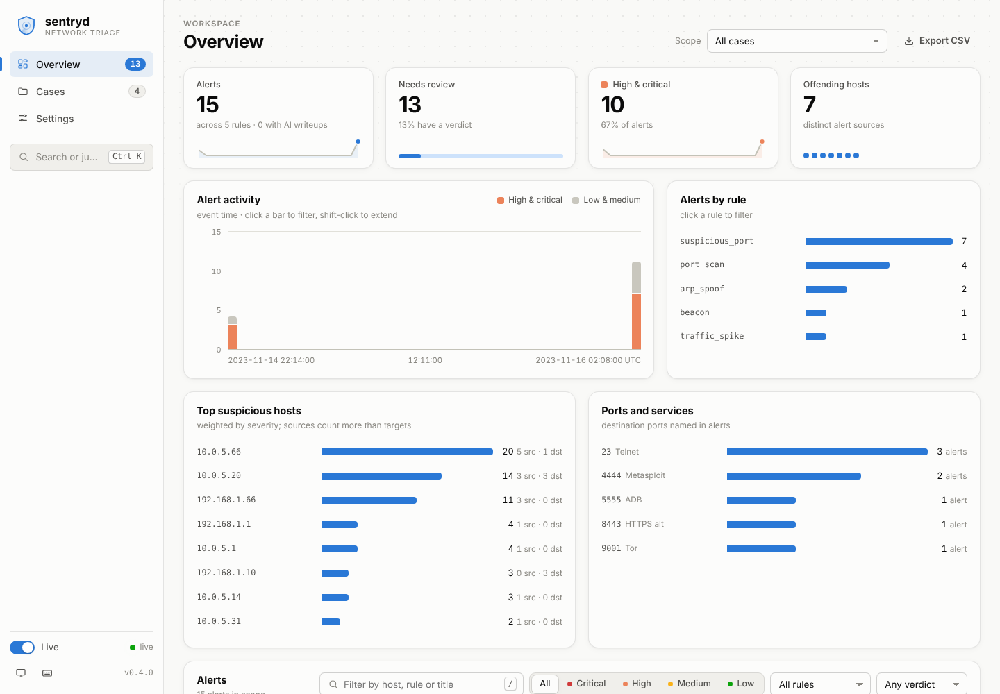

# sentryd

A small network anomaly detector. Detection is rule-based and runs fully
offline. An optional AI layer writes up explanations for alerts after they
fire.

The AI never decides what gets detected. The whole tool works without an API
key.



## What it detects

| rule | what it catches |
|---|---|
| `port_scan` | vertical scans and horizontal sweeps |
| `traffic_spike` | floods and exfil-style bursts against a per-host baseline |
| `arp_spoof` | IP-to-MAC conflicts and gratuitous ARP floods |
| `suspicious_port` | traffic to known-bad ports, from a configurable watchlist |
| `signature` | anything stateless you can describe in YAML |

Each alert includes a severity, a confidence score, and the raw evidence
behind it (ports, MACs, byte counts), so you can check the finding yourself.

Thresholds and watchlists live in [`config/signatures.yaml`](config/signatures.yaml).

## Setup

You need Python 3.11+ and [uv](https://docs.astral.sh/uv/).

```bash
git clone https://github.com/H4ch1Net/sentryd && cd sentryd
uv sync
uv run pytest
```

Or with Docker:

```bash
docker compose up --build     # http://localhost:8000
```

To turn on AI explanations, copy `.env.example` to `.env` and set
`OPENROUTER_API_KEY`. Set `SENTRYD_API_TOKEN` if you expose the web port.

## Quick demo

Replay the bundled synthetic capture. It has a port scan and a connection to
a suspicious port mixed into normal background traffic:

```bash
uv run sentryd replay tests/fixtures/portscan.pcap
uv run sentryd cases show 1
uv run sentryd alerts show 2
```

Or watch a replay in the terminal dashboard:

```bash
uv run sentryd dash --pcap tests/fixtures/arpspoof.pcap --speed 4
```

Or open the web console:

```bash
uv run sentryd web            # http://127.0.0.1:8000
```

## Cases

Every replay or capture becomes a case. Alerts are tied to the case that
produced them, so runs don't get mixed together. A case keeps its source,
event count, time span, notes, and AI report if you generated one.

## Input sources

```bash
uv run sentryd replay capture.pcap        # pcap / pcapng
sudo uv run sentryd sniff -i eth0         # live capture (needs root)
uv run sentryd tail traffic.log           # JSON-lines log
```

All three sources feed the same event stream, so rules behave the same
whichever one you use.

## AI review

Per-alert explanations and a whole-case review are both optional:

```bash
uv run sentryd triage 2               # explain one alert
uv run sentryd triage latest          # review the newest case
```

Only a short summary of alert metadata is sent to the model, never raw
packets, and only when you run one of these commands.

## Exports

```bash
uv run sentryd export alerts --format csv -o alerts.csv
uv run sentryd export case 1 --format md -o report.md
uv run sentryd export case 1 --format json
```

## Rules

```bash
uv run sentryd rules list
uv run sentryd rules explain suspicious_port
uv run sentryd rules lint
uv run sentryd rules test --rule port_scan --pcap cap.pcap
```

`rules test` runs a rule against a capture without storing anything.

## Configuration

`config/signatures.yaml` overrides the defaults. You only need to list what
you want to change:

```yaml
rules:
  port_scan:
    min_distinct_targets: 10

signatures:
  - id: sig-rdp-inbound
    title: Inbound RDP connection attempt
    severity: high
    match:
      protocol: tcp
      dst_ports: [3389, "5900-5910"]
      tcp_flags: S
      tcp_flags_not: A
```

## Web API

The web console is a single page with a REST API behind it. Interactive docs
are at `/docs`.

The API listens on `127.0.0.1` by default. Set `SENTRYD_API_TOKEN` to require
a bearer token, and `SENTRYD_PCAP_DIR` to allow server-side replay from a
directory. Put TLS or a reverse proxy in front before exposing it publicly.

## Project layout

```
src/sentryd/
├── core/      events, alerts, cases, rule engine, correlation
├── sources/   pcap, live capture, log tailing
├── rules/     one module per rule, plus config-driven signatures
├── triage/    AI providers, digest, review
├── storage/   SQLite store
└── web/       FastAPI app and static console
```

Architecture notes for contributors are in [AGENTS.md](AGENTS.md).

## Testing

```bash
uv run pytest
```

The tests run offline. Rules are tested against hand-built events and
synthetic pcaps, including traffic that should not fire. The demo captures
are generated by `uv run python tests/fixtures/generate.py`.
