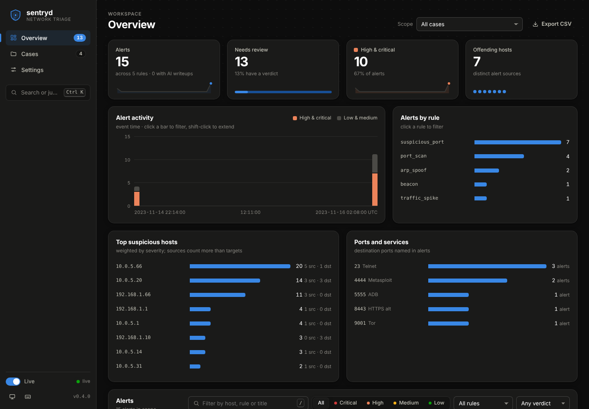
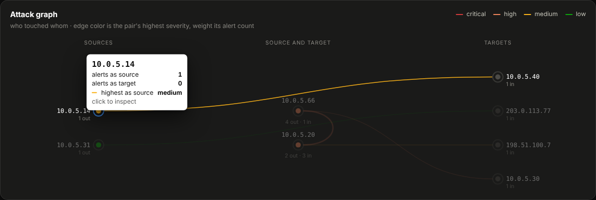

# sentryd

A small network anomaly detector. Detection is rule-based and runs fully
offline. An optional AI layer writes up explanations after alerts fire.

The AI never decides what gets detected, and the whole tool works without an
API key.

Built with Python 3.11+, scapy, FastAPI, SQLite, Typer, and Textual.



## What it detects

| rule | what it catches |
|---|---|
| `port_scan` | SYN, FIN, and XMAS scans, and horizontal sweeps |
| `beacon` | command-and-control check-ins on a steady rhythm |
| `traffic_spike` | floods and exfil-style bursts |
| `arp_spoof` | ARP cache poisoning and MITM setups |
| `suspicious_port` | traffic to known-bad ports |
| `signature` | anything you can describe in YAML |

Every alert has a severity, a confidence score, and the evidence behind it
(ports, MACs, byte counts), so you can check the finding yourself. Thresholds
and watchlists live in [`config/signatures.yaml`](config/signatures.yaml).

## How it works

Pcap replay, live capture, and log tailing all produce the same `Event`
records. Rules never touch packets, so a rule behaves the same on a file and
on a live interface.

Windows, baselines, and dedup cooldowns run on packet timestamps, so a replay
behaves like the original capture.

Repeat hits from the same rule, source, and destination merge into one alert
within a cooldown. A rule that can raise several distinct findings for one
host pair sets its own key so those never merge.

`port_scan` counts probe segments in a sliding window and tracks the distinct
host/port targets each source reaches. `beacon` looks at the spacing between
a flow's contacts and fires once a steady rhythm is established. `traffic_spike`
compares each host against an EWMA baseline. `arp_spoof` tracks which MAC each
IP has claimed.

Alerts from one source are grouped into a cluster, with its phases listed in
kill-chain order. Each cluster and case gets a 0-100 risk score built from
named factors. This is all deterministic. No AI is involved.

Alerts and cases live in SQLite through the standard library, with no ORM.

The AI layer runs only when you ask it to, and it gets a size-capped summary
of alert metadata, never packets.

## Quick start

You need Python 3.11+ and [uv](https://docs.astral.sh/uv/).

```bash
git clone https://github.com/H4ch1Net/sentryd && cd sentryd
uv sync
uv run pytest
make demo     # replay the bundled capture into a case
make web      # console on http://127.0.0.1:8000
```

Or with Docker:

```bash
docker compose up --build     # http://localhost:8000
```

Data (the SQLite database and uploaded pcaps) lives in a named volume.

To turn on AI explanations, copy `.env.example` to `.env` and set
`OPENROUTER_API_KEY`.

## Demo

The bundled capture is synthetic. It has a port scan and a connection to a
suspicious port hidden in ordinary background traffic.

```bash
uv run sentryd replay tests/fixtures/portscan.pcap
uv run sentryd cases show 1
uv run sentryd alerts show 2
```

To watch a replay in the terminal dashboard:

```bash
uv run sentryd dash --pcap tests/fixtures/arpspoof.pcap --speed 4
```

## Cases

Every replay or capture becomes a case, so runs don't get mixed together. A
case keeps its source, hashes, event count, time span, notes, risk score, and
AI report if you generated one. Cases can be archived or cleared.

## Input sources

```bash
uv run sentryd replay capture.pcap        # pcap / pcapng
sudo uv run sentryd sniff -i eth0         # live capture (needs root)
uv run sentryd tail traffic.log           # JSON-lines log
```

The log format is one JSON object per line with `ts`, `protocol`, `src_ip`,
`dst_ip`, `src_port`, `dst_port`, `tcp_flags`, and `length`. Lines that don't
parse are skipped and counted.

## Working a case

Each alert shows what fired and why, with the actual numbers, plus the
evidence to verify it and a suggested next command. Mark each alert as
confirmed, false positive, expected, ignored, or dismissed, from the web
drawer or with `sentryd alerts status <id> <verdict>`. Verdicts work without
an AI provider.

## AI review

Per-alert explanations and a whole-case review are both optional:

```bash
uv run sentryd triage 2               # explain one alert
uv run sentryd triage latest          # review the newest case
uv run sentryd triage --case 1 --json # machine-readable
```

The review covers the attack chain, suspicious hosts and ports, a timeline,
what to investigate next, and likely false positives. It is built from the
size-capped digest only. Without a key, detection and evidence are unchanged.

## Exports

```bash
uv run sentryd export alerts --format csv -o alerts.csv
uv run sentryd export case 1 --format md -o report.md
uv run sentryd export case 1 --format json
```

The markdown report is useful on its own. If an AI review exists, it gets
appended as a separate section.

## Rules

```bash
uv run sentryd rules list
uv run sentryd rules explain suspicious_port
uv run sentryd rules lint
uv run sentryd rules test --rule port_scan --pcap cap.pcap   # nothing stored
```

## Web console

`sentryd web` serves a single-page console with no build step. You can upload
captures, browse cases, drill into alerts, edit notes, export, and run reviews.
Settings cover theme, density, and rule on/off switches.

The keyboard works too. Ctrl+K opens a command palette. J and K move through
alerts, 1 to 5 set a verdict, X selects rows for a bulk verdict, and ? lists
the rest. Every verdict change has an undo.

The console polls a single change counter and refreshes only when something
changed, so an idle console costs almost nothing.



## Configuration

`config/signatures.yaml` overrides the defaults. You only need to list what
you want to change:

```yaml
rules:
  port_scan:
    min_distinct_targets: 10

signatures:
  - id: sig-rdp-inbound
    title: Inbound RDP connection attempt
    severity: high
    match:
      protocol: tcp
      dst_ports: [3389, "5900-5910"]
      tcp_flags: S
      tcp_flags_not: A
```

## HTTP API

The web console sits on a REST API. Interactive docs are at `/docs`.

The API listens on `127.0.0.1` by default. Set `SENTRYD_API_TOKEN` to require
a bearer token, and `SENTRYD_PCAP_DIR` to allow server-side replay from a
directory. Put TLS or a reverse proxy in front before exposing it.

## For contributors

The package lives in `src/sentryd/`. Architecture notes and conventions are in
[AGENTS.md](AGENTS.md).

```bash
uv run pytest
```

The tests run offline. Rules are tested against hand-built events and
synthetic pcaps, including traffic that should not fire. Regenerate the demo
captures with `uv run python tests/fixtures/generate.py`.
